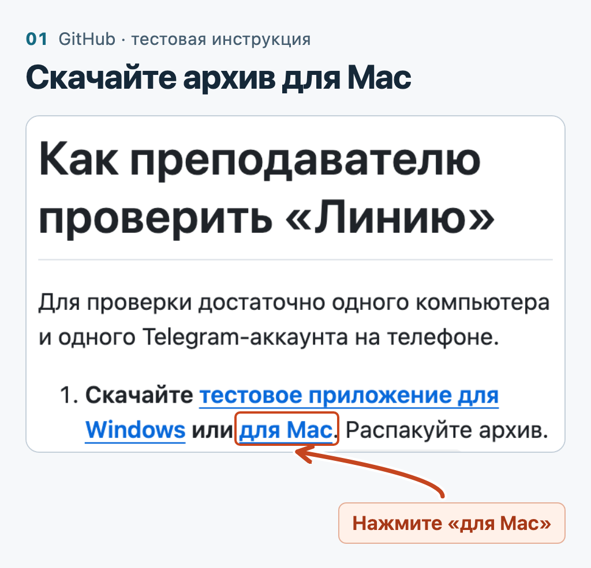
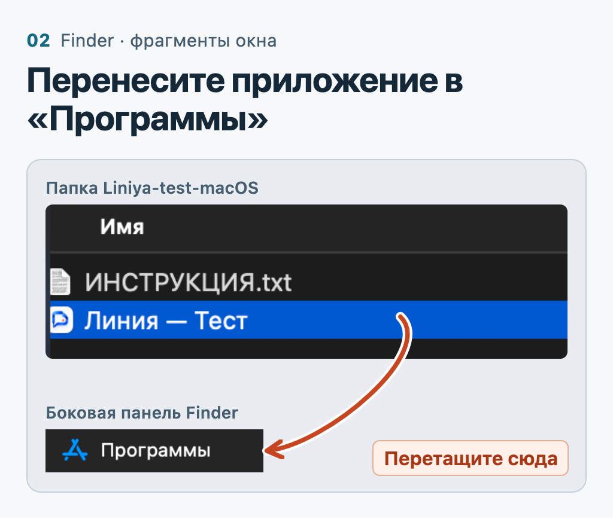
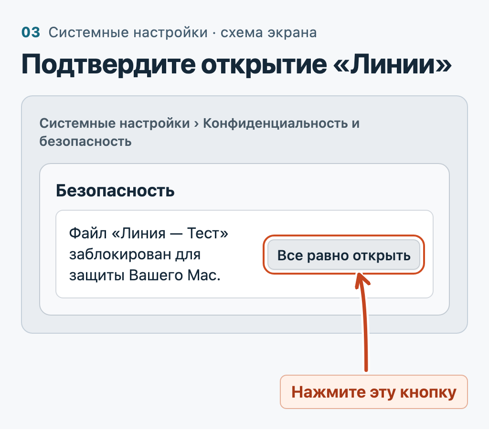
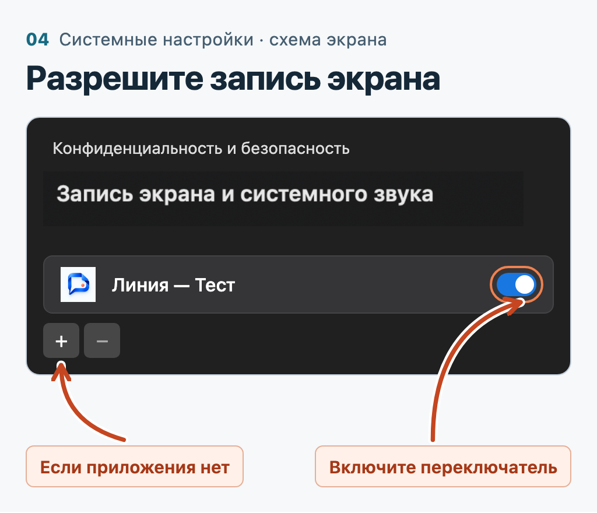
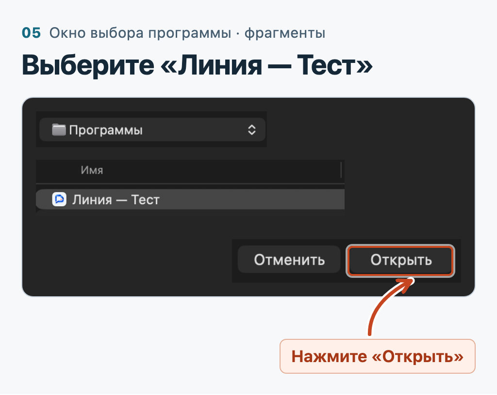
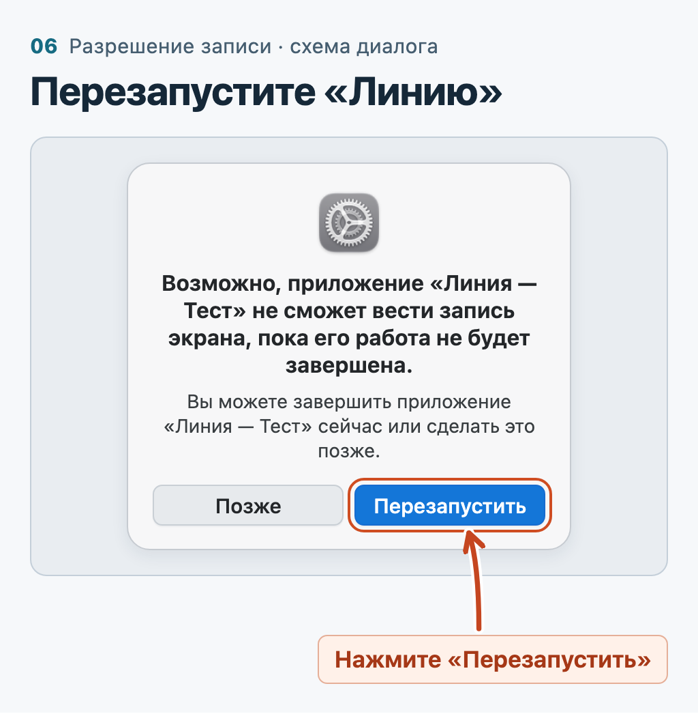
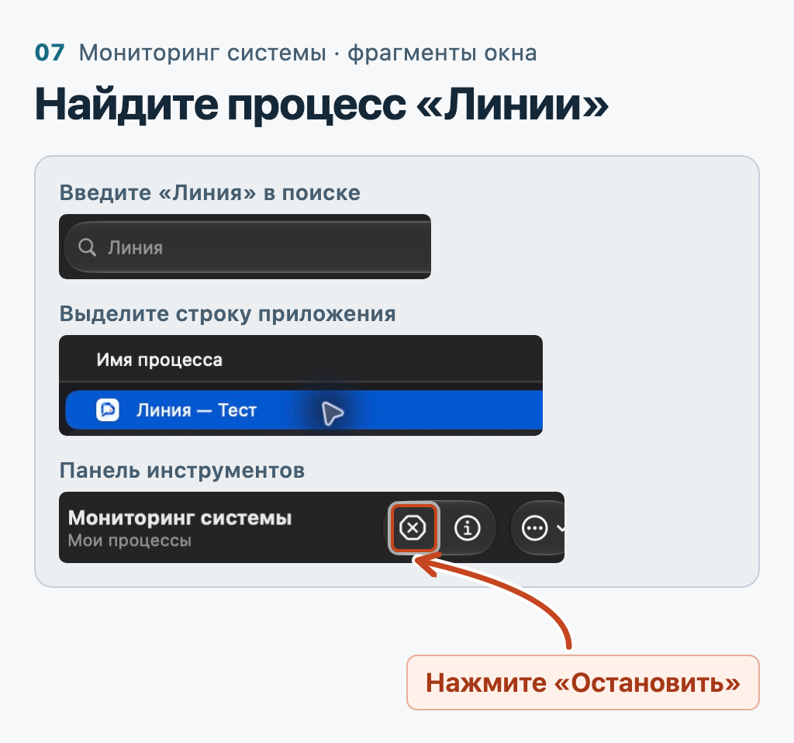

# Первый запуск на Mac

Для macOS 14 и новее. На картинках показана **«Линия — Тест»**. Для занятия выполняйте те же шаги с приложением **«Линия — ваше имя»**.

### 1. Скачайте ZIP

Откройте [таблицу учеников](README.md), найдите своё имя и нажмите **«Скачать для Mac»**. Для самостоятельной проверки преподавателю нужна ссылка **«для Mac»** на [странице теста](TEST.md).

### 2. Откройте приложение через Finder

**Finder → Загрузки**. Дважды нажмите ZIP, затем откройте распакованную папку. Перетащите **«Линия — ваше имя»** в **«Программы»** в боковом меню. Откройте **«Программы»** и дважды нажмите «Линию». Она работает в фоне.

### 3. Если macOS заблокировала первый запуск

Для копии, скачанной из [выпуска «Линии»](https://github.com/Uutotora/liniya-apps/releases), закройте предупреждение о непроверенном разработчике. Откройте ** → Системные настройки → Конфиденциальность и безопасность**. Внизу, в разделе **«Безопасность»**, рядом с именем «Линии» нажмите **«Все равно открыть»** и подтвердите. На некоторых версиях кнопка называется **«Подтвердить вход»**. Если приложение уже открылось, переходите к шагу 4. [Справка Apple](https://support.apple.com/ru-ru/102445)

### 4. Включите запись экрана

**Системные настройки → Конфиденциальность и безопасность → Запись экрана и системного звука** (на некоторых Mac — **«Запись экрана»**). Включите переключатель рядом с **«Линия — ваше имя»**. Если программа уже есть в списке, переходите к шагу 6.

### 5. Если «Линии» нет в списке

Нажмите **+** под списком. Выберите **Программы → Линия — ваше имя → Открыть**. Проверьте, что переключатель включён. Если приложение установлено в *личную* папку «Программы», нажмите **⇧⌘G**, введите `~/Applications` и нажмите **Return**.

### 6. Перезапустите и проверьте

Если macOS предложит, нажмите **«Перезапустить»** (или **«Завершить и открыть снова»**). При необходимости завершите процесс по инструкции ниже и снова откройте «Линию» из «Программ».

На телефоне откройте [бота из своей строки](README.md) и нажмите **Старт → Я ученик**. Для [теста преподавателя](TEST.md) выберите **«Я преподаватель»**. Покажите на Mac пробное задание, наведите указатель на нужный монитор и один раз нажмите **↓**. В чате появится **«Скриншот №…»**.

### Как завершить после занятия

Дождитесь доставки снимков. Нажмите **⌘ + пробел**, введите **Мониторинг системы** и откройте его. В поиске введите **Линия** кириллицей. Выделите процесс со своим именем, например **«Линия — Лиза»**. Для тестовой сборки точное имя — **«Линия — Тест»**. Нажмите **ⓧ Остановить → Завершить**. Когда строка исчезнет, клавиша ↓ снова будет работать как обычно.

[Ошибка −47 или снимок не пришёл](APP.md#mac) · [Вернуться к скачиванию](README.md)
