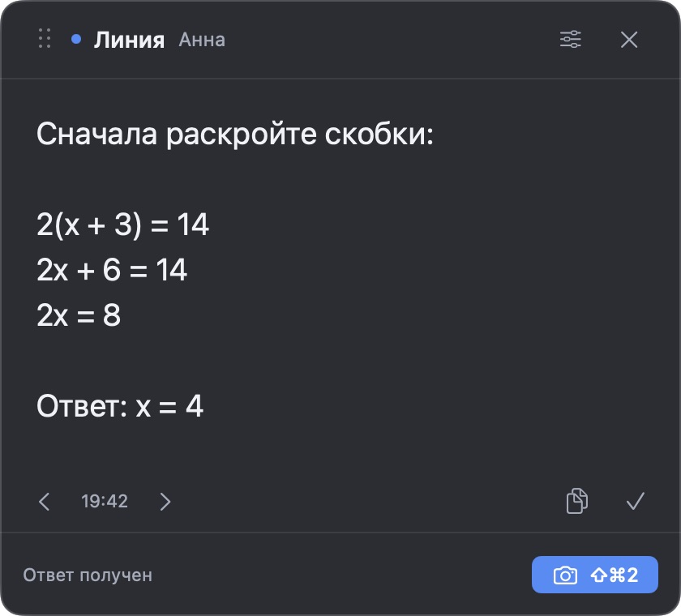
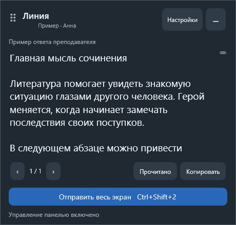

# Линия — скачать приложение

## 1. Найдите своё имя

Нажмите **«Скачать»** в своей строке. Загрузка архива начнётся сразу.

| Ваше имя | Компьютер | Приложение |
|---|---|---|
| Лиза | Mac | **[Скачать](https://github.com/Uutotora/liniya-apps/releases/download/students-v2.2.0/Liniya-liza-macOS.zip)** |
| Илья | Mac | **[Скачать](https://github.com/Uutotora/liniya-apps/releases/download/students-v2.2.0/Liniya-ilya-macOS.zip)** |
| Арсений | Mac | **[Скачать](https://github.com/Uutotora/liniya-apps/releases/download/students-v2.2.0/Liniya-arseniy-macOS.zip)** |
| Роман | Windows | **[Скачать](https://github.com/Uutotora/liniya-apps/releases/download/students-v2.2.0/Liniya-roman-Windows-win-x64.zip)** |
| Варя | Windows | **[Скачать](https://github.com/Uutotora/liniya-apps/releases/download/students-v2.2.0/Liniya-varya-Windows-win-x64.zip)** |
| Матвей | Windows | **[Скачать](https://github.com/Uutotora/liniya-apps/releases/download/students-v2.2.0/Liniya-matvey-Windows-win-x64.zip)** |
| Никита | Windows | **[Скачать](https://github.com/Uutotora/liniya-apps/releases/download/students-v2.2.0/Liniya-nikita-Windows-win-x64.zip)** |
| Иван | Windows | **[Скачать](https://github.com/Uutotora/liniya-apps/releases/download/students-v2.2.0/Liniya-ivan-Windows-win-x64.zip)** |
| Дарья | Windows | **[Скачать](https://github.com/Uutotora/liniya-apps/releases/download/students-v2.2.0/Liniya-darya-Windows-win-x64.zip)** |
| Мария | Windows | **[Скачать](https://github.com/Uutotora/liniya-apps/releases/download/students-v2.2.0/Liniya-mariya-Windows-win-x64.zip)** |
| Эля | Windows | **[Скачать](https://github.com/Uutotora/liniya-apps/releases/download/students-v2.2.0/Liniya-elya-Windows-win-x64.zip)** |

## 2. Распакуйте и откройте

**На Windows:** откройте «Загрузки» → нажмите правой кнопкой на скачанный архив → **«Извлечь всё»** → откройте полученную папку → дважды нажмите **Liniya.exe**.

**На Mac:** откройте «Загрузки» → дважды нажмите на архив → перенесите приложение **«Линия — ваше имя»** в папку **«Программы»** → откройте его. Разрешите **«Запись экрана»**, когда macOS попросит.

Если компьютер не даёт открыть приложение, отправьте преподавателю скриншот сообщения.

## 3. Подключитесь и пользуйтесь

При первом запуске сообщите преподавателю **номер подключения**, который покажет Линия. Дождитесь его подтверждения.

После подключения отправьте экран — ответ преподавателя появится в панели:

| Mac — пример ответа | Windows — пример ответа |
|:---:|:---:|
|  |  |

| Что сделать | Mac | Windows |
|---|---|---|
| Отправить весь экран | **⌘ Shift 2** | **Ctrl Shift 2** |
| Показать / скрыть панель | **⌘ Shift Пробел** | **Ctrl Shift Пробел** |

В настройках можно выбрать **одну удобную клавишу** вместо сочетания. Если панель пропала, просто откройте приложение ещё раз. Для работы нужен интернет.

## Для преподавателей

[Открыть список ботов и инструкцию входа](TEACHERS.md).

## Для тестирования

Отдельный [бот «Линия»](https://t.me/liniya_class_20261012_bot) и приложения **«Линия — Тест»**:

- **[Скачать для Mac](https://github.com/Uutotora/liniya-apps/releases/download/testing-v2.2.0/Liniya-test-macOS.zip)**
- **[Скачать для Windows](https://github.com/Uutotora/liniya-apps/releases/download/testing-v2.2.0/Liniya-test-Windows-win-x64.zip)**

Откройте тестовое приложение и подтвердите его номер в общем боте. Оба тестовых компьютера видят общую историю. Кабинеты учеников отдельные.
