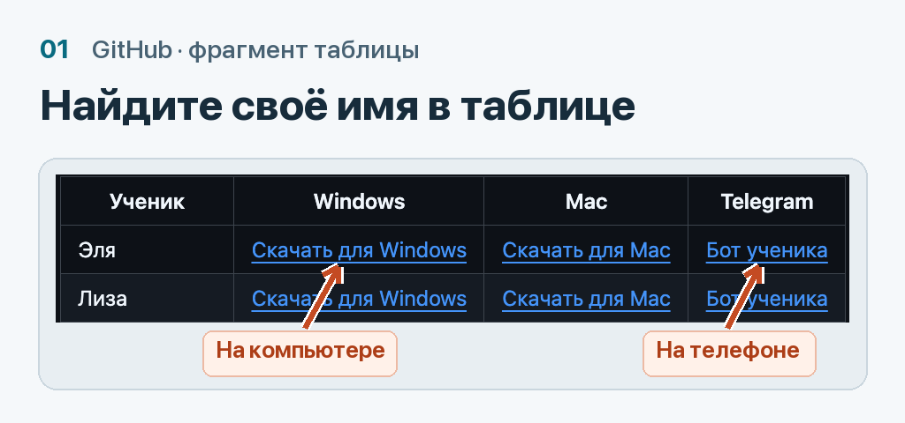
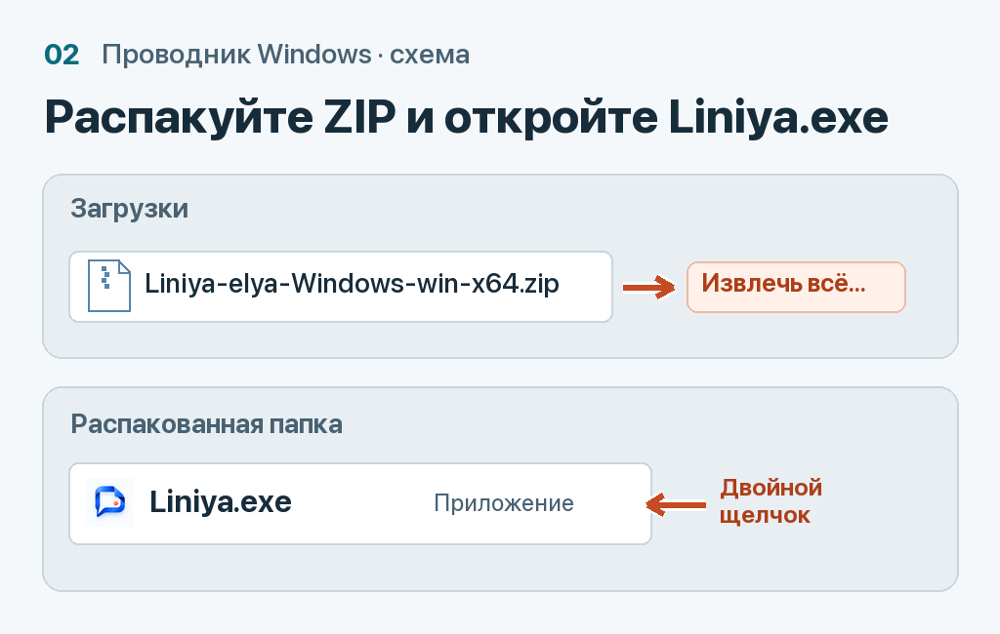
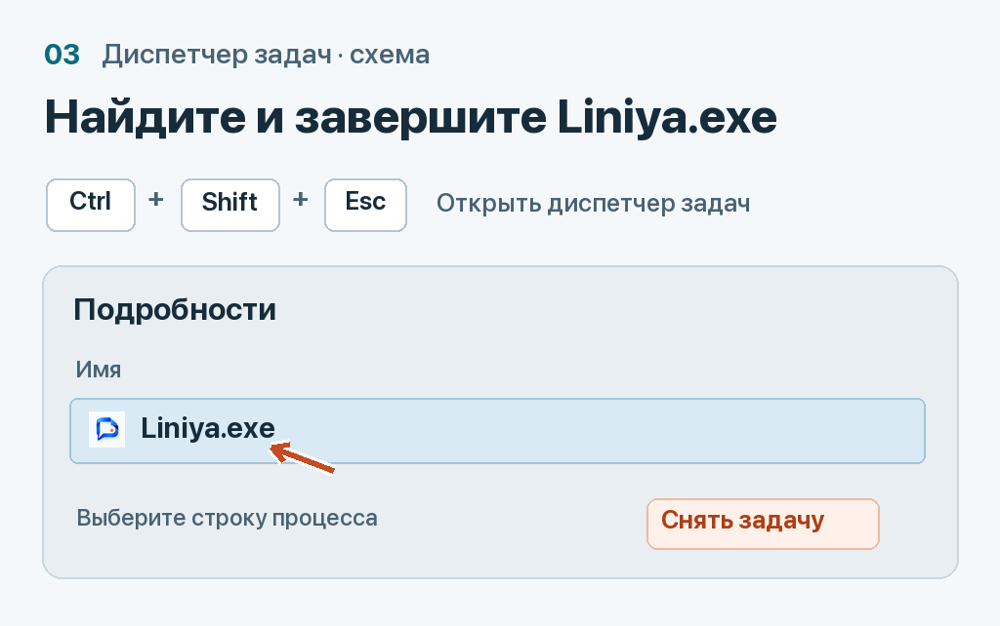

# Как запустить «Линию» на Windows

## 1. Скачайте приложение для своего бота

**Для занятия.** На компьютере откройте таблицу учеников, найдите своё имя и нажмите **«Скачать для Windows»**. На телефоне откройте **«Бот ученика»** из той же строки и выберите **Старт → Я ученик**. [Таблица учеников](README.md)

**Для проверки преподавателем.** Откройте страницу теста и нажмите **«тестовое приложение для Windows»**. На телефоне войдите в тестовый бот через **Старт → Я преподаватель** и введите пароль, когда бот попросит. Для проверки достаточно одного Telegram-аккаунта. [Страница теста](TEST.md)

## 2. Распакуйте ZIP, запустите приложение и проверьте снимок

В **Проводнике → Загрузки** щёлкните скачанный ZIP правой кнопкой. Выберите **«Извлечь всё…»**, затем **«Извлечь»**. В распакованной папке откройте вложенную папку с названием сборки и дважды щёлкните **`Liniya.exe`**. Если Windows скрывает расширения, ищите **Liniya** с типом **«Приложение»**. [Справка Microsoft о распаковке ZIP](https://support.microsoft.com/ru-ru/windows/experience/storage-filemanagement/zip-and-unzip-files)

Если при открытии появилось предупреждение Windows, закройте его и запишите точный текст. [Если на Windows что-то не работает](WINDOWS-HELP.md)

Нажмите **☰** возле часов (проверьте также скрытые значки). Проверьте имя и бот в меню, включите отправку. Покажите задание и нажмите **↓** или **↑**. Строка состояния в ☰ покажет результат. Пункт **«Отправить пробный снимок»** проверяет передачу без клавиатуры. После занятия дождитесь снимка в чате и выберите **☰ → Выйти**.

## 3. После занятия закройте «Линию»

Дождитесь последних снимков в Telegram. Нажмите **Ctrl + Shift + Esc**, в «Диспетчере задач» откройте **«Подробности»** (в некоторых версиях **«Сведения»**). Если в Windows 10 открылось маленькое окно, сначала нажмите **«Подробнее»**. Выделите **`Liniya.exe`**, нажмите **«Снять задачу»** и подтвердите завершение. Строка исчезнет. [Сочетания клавиш Windows](https://support.microsoft.com/ru-ru/accessibility/windows/keyboard-shortcuts-in-windows)

На следующем занятии снова откройте `Liniya.exe` из той же папки. Если снимок не пришёл, запустите из неё **«Проверить работу.cmd»**, чтобы увидеть, какая копия работает. [Как проверить запуск](APP.md#windows)

Эти архивы предназначены для компьютеров Intel/AMD x64 с Windows 10 (сборка 19041 или новее) и Windows 11.
